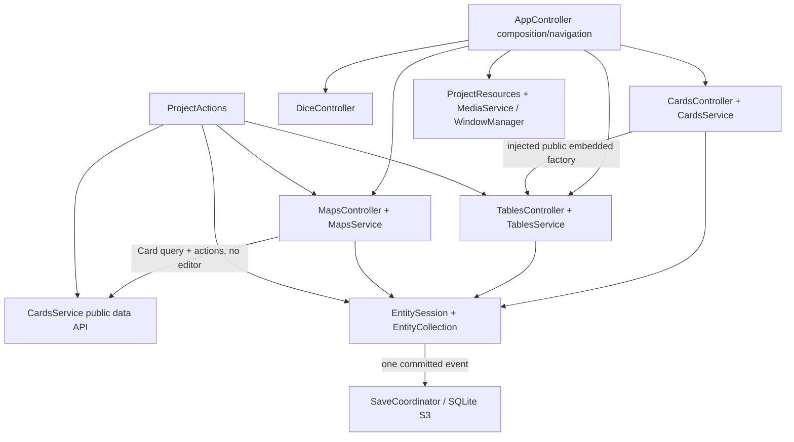

# ADR-027 — функциональные границы итерации 6

Контекст: be24ec2 имеет общий канон и слои, но ModuleController владеет Maps/Tables/Dice,
worker/tiles/drafts/UI registries и читает CardEditor._model. ModuleSession смешивает Map
commands/Undo и Table operations. ApplicationSession содержит межмодульный inventory use
case. ProjectController/workspace_state читают чужие private registries. Это фактическая
связность, которую нельзя исправить перестановкой каталогов. Требование ARU-84 принято
в составе iteration6-rev3, повторного согласования нет.

Решение: разделить владельцев вертикально, сохранить зрелые domain/UI/codec файлы.

| Владелец | Публичная граница | Не владеет |
|---|---|---|
| EntitySession (Core) | EntityCollection, selection, typed structural events, transaction/after-commit/revision notification | Cards/Map/Table widgets/payload commands |
| CardsService / CardsController | Card mutation/query/catalog, field drafts; editor/document lifecycle, injected embedded-view factory | Table rows, Map workers/Undo, Dice |
| TablesService / TablesController | columns/rows/cells, drafts/commit/conflict; addressed views, standalone/embedded factory, UI preferences | CardEditor internals, Map/Dice |
| MapsService / MapsController | placements/layers/objects/Undo; viewer+editor, tiles/import and separate camera state | CardEditor, Table rows, Dice |
| DiceController | tool:dice/runtime/history through WindowManager | Entity/SQL/project dirty |
| ProjectActions | atomic Card+Token, Card delete+placements, child Table link, post-commit events | widgets |
| ProjectResources / MediaService | current store/assets/root/generation, bounded immutable media/cache/import | feature editors and model commands |
| AppController | explicit composition/wiring, navigation/Tree; public lifecycle operations | row/cell/token business logic and private feature registries |

Module services receive Core and narrow public query/callback dependencies explicitly;
no global locator, EventBus, ORM, second store, dependency framework or Protocol per method.
Cards passes embedded Table construction through an injected public factory. Table cell
events update only Table views, never rebuild Card header. Core structural events notify
Card of moved/deleted link targets. Maps receives Card queries and media metadata, not
CardEditor. Cross-feature actions validate candidates before one Entity transaction;
notifications follow commit, one revision change for a compound operation.

Services/UI state reset by project generation through public APIs; worker cancellation
and subscriptions have one owner. Persistence remains the explicit built-in integration
boundary: one SQLite snapshot and module codecs; full snapshot/backup rewrite out of scope.
Shared datatypes and integration adapters have documented allowlists. AST tests enforce
layer/module rules and import acyclicity; tests run services with minimal shared doubles.
Before/after import graph, actual tree and draw.io schema are recorded with final evidence.

No claim of complete independence while runtime sibling-private accesses remain. Revisit
only when a concrete new module requires a broader contract, rather than adding SDK now.

## Фактический результат A

ModuleController/ModuleSession/ApplicationSession/CardImages удалены. AppController —
composition/navigation, CardsController владеет Card UI и injected Table factory,
TablesController обновляет только свои views, MapsController получает публичные Card
query/actions/media APIs без CardEditor/creation dialog import; DiceController независим.
MOW больше не заимствует private Map worker: собственный BackgroundTasks. Workspace и
project lifecycle используют public capture/restore/reset/drafts APIs. EntitySession
defer/transaction обеспечивает post-commit events и один revision notification для
Card+Token/child inventory/cascade. Каждая import operation имеет собственный cancel
Event; reset инвалидирует generation, callbacks не попадают в новый проект.

AST before66 modules/145edges/0cycles; afterA75/157/0. Больше файлов не является метрикой
независимости: запрещённые sibling services/UI imports проверяются тестом, integration
allowlist ограничен root/actions/storage/payload codecs, domain не импортирует Qt/SQL/UI.
A targets30passed6.18s; integration63passed/1 stale test API assertion, worker group17passed
(8.98s); устаревший доступ Map.get_table перенесён в TablesService, проверяется узко.
Итоговые числа/проверка реального ввода и draw.io фиксируются после B–E.

## Gate перед дальнейшей модульной разработкой

Финальная стабилизация7, ARU-84: test_module_boundaries содержит полный явный ownership
runtime-файлов Cards/Tables/Maps/Dice, включая bindings/codecs/helpers и Maps presentation/
fog. Новый или удалённый файл требует обновления owner table; пакеты также учитываются.
AST resolver нормализует __init__ и absolute/relative/from-package alias imports,
включая локальные/отложенные imports; код приложения при анализе не выполняется.
Проверяются все reachable edges через собственные и общие helpers, не только controller/
service. Domain остаётся без Qt/SQL/application/UI; прикладные helpers/services не
получают UI транзитивно. Negative fixtures доказывают обнаружение каждого варианта.

Built-in integration allowlist: main/AppController/ProjectController, ProjectActions,
save/store/workspace, domain.document_payloads и фиксированные shell adapters
AppShell/Inspector/Tree. Feature code не получает свободный доступ к composition:
разрешены лишь существующие CardCollection→document_payloads, CardInspectorBinding→
Inspector и WindowManager→AppShell edges. Единственный узкий cross-domain контракт
MapDocument→card_schema.CARD_TYPES валидирует сохранённый тип token override; импорт
других Card symbols не разрешён. Entity picker/semantic edits/conflict bar/media/Core
остаются shared. Архитектура/каталоги и production dependencies не перестраивались;
draw.io остаётся актуальной схемой владельцев.

Итог6: полный pytest394passed/1skip64.76s, после финальных local fixes targeted29passed3.66s (включая новый constraint regression) и22passed2.52s portrait/layout. Ruff/pip/diff clean. Actual imports83modules/174edges/0cycles; draw.io и JSON в docs/architecture. Подробные measurements/build/native limitations — единый отчёт6.

## Дополнение 21.11.2026 — ADR-033

Cards владеет ActorState/default, FieldDefinition scopes, pure rules/formulas и actor
DTO. Core settings opaque, prepare(final aggregate) внедряется composition root;
validation до post-commit. ProjectActions объединяет Actor+inventory+placement receipt.
Maps получает participant resolver/addressed callbacks; Table остаётся общей таблицей.
Нет нового registry/service locator/сессии. Actor events по Card+Actor ID; bounded
derived cache не канон. Фактический AST96modules/220imports/0cycles, imports-cards5e14.json.

## Дополнение UI-приёмки — ADR-034

GameSheetBinding, game_sheet/game_labels/item_page/hit_history явно Cards-owned в
AST gate. Системные страницы UI используют прежние addressed public contracts. Maps
получает callback перехода к Card+ActorRef из composition root, не импортирует
private Card widgets. Общие FieldEdits/ConflictBar/Qt theme остаются shared.
Фактический граф: 101 модуль / 250 связей / 0 циклов (imports-ui-acceptance.json).

## Дополнение 22.11.2026 — ADR-035

Лист v2 и equipment facts заменяют сохранённую броню/щит Card и прежние proficiency
формы. Новый SQLite16/Card7/profile2 по прямому разрешению владельца «все миры тестовые»;
миграций/legacy нет, старые файлы отклоняются без записи. Actor/Token ownership,
FieldEdits, native document lifecycle и функциональные границы сохранены.
Generic Tables cell hooks собирает composition root; pure EquipmentFacts и профиль —
Cards. AST105modules/264edges/0cycles, gate не ослаблен. Подробности и критерии1–7:
docs/validation/2026-11-22-character-sheet-v2.md.

## Дополнение 27.11.2026 — адресная проверка транзакций v0.01

EntityCollection сохраняет исходные версии затронутых Entity и payload по
точкам вложенного отката. Изменение порядка соседей и ProjectSettings входит
в тот же набор. Cards использует предварительный набор для reconcile.
Каноническая проверка и публикация используют итоговый набор, включая HP,
ограниченные reconcile. После успешной проверки EntitySession публикует
номер поколения, serial и набор изменений перед сигналом сохранения.
Уведомления представлений выполняются по прежнему контракту S1.

На проверенной runtime-коллекции обратный индекс Item → Table выводится
из ссылок типизированных строк. Он меняется после успешной проверки и
строится заново при смене коллекции. Авторитетная связь Actor с инвентарём
хранится в CardPayload. Общие проверки Card, Actor, Table и Map используются
как адресной, так и полной валидацией. Структурные изменения, настройки и
операции с несколькими изменёнными картами проходят полную проверку.
Открытие, миграции и восстановление используют полный валидатор.

Обычное изменение карты поступает в историю после подтверждения. Undo/Redo
сохраняют проверку конфликта со свежим состоянием перед изменением индекса.
Представления реагируют на изменение размещений и названий карт отдельно
от изменения геометрии.

Набор изменений хранится в памяти для последней ревизии сессии. Регистрация
вложений продолжает использовать существующее уведомление об изменении.
Будущей инкрементальной записи потребуется согласование непогашенных ревизий
и учёт вложений. SaveCoordinator и полный SQLite writer продолжают работать
по текущему контракту. Форматы данных сохранены.
[Аудит и замеры S3](../architecture/v001-audit.md#s3--адресные-транзакции)
