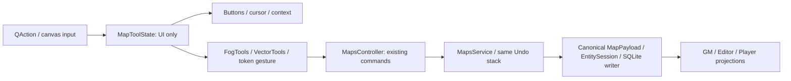

# MVP Map M5.5 — инженерный отчёт

25–26.11.2026 · [ARU-91](https://linear.app/aruzento/issue/ARU-91/mvp-map-m55-edinaya-panel-instrumentov-karty) · [ADR-037](../adr/037-unified-map-tool-state.md).

Единая панель игровой карты реализована. Подготовлен Windows-кандидат
`LODANDSY-Map-M5.5-2026-11-25.zip`. Новая ручная приёмка остаётся за владельцем;
ARU-91 сохраняется In Progress. Commit/push/merge не выполнялись.

## Baseline и изученные источники

HEAD до и после работы: `e40a25da2daf35f63e9e69454101a68659ffee6d`, ветка `codex/map-m5`.
Отслеживаемое дерево на старте чистое. Принятый владельцем M5 прошёл82/82 сценария,
включая Windows без Python. [Baseline CI45593209185](https://github.com/Aruzento/lodandsy/actions/runs/45593209185)
успешен. Новый CI не запускался: Git-публикация текущим заданием запрещена.
Прежние untracked attachments/references и локальный architecture audit сохранены и
исключены из source bundle. Пользовательские миры не изменялись.

Изучены AGENTS.md, START-CODEX.md, README.md, docs/MVP.md, ADR-027/030/031/032/033–036,
iteration-7-stabilization, M5 validation, LODANDSY.drawio и актуальная ARU-91.
Перед изменениями разобраны MapWidget/MapView, FogTools, VectorTools, annotations,
MapsController, MapsService/Undo, presentation и M5 tests. Раннее предложение Linear
«согласовать структуру» заменено последующим прямым утверждением владельца.
Итерация7 и принятые Cards/Actors/5e14 не перерабатывались.

Форматы сохранены: **SQLite16/Card7/Map8/Actor1/Rules1(profile2)/Table3/UIstate4**.
Нет миграций, новых зависимостей, функциональных инструментов или второго Undo.

## Компоновка и поведение

Слева native QToolBar, группы разделены отступами:

1. Выбор и рука.
2. Добавление токена и параметры измерения при drag токена.
3. Последняя фигура с меню шести форм, вершины, портал.
4. Кисть, ластик, полигон и выбор области тумана.

Круг/прямоугольник/треугольник/четырёхугольник/конус/многоугольник используют прежние
обработчики геометрии. Основная кнопка запоминает последнюю форму в экземпляре карты.
Прежний shape QComboBox удалён. Измерения остаются параметрами существующего token drag;
отдельная линейка не добавлена.

Сверху: прежние Undo/Redo, быстрый enabled сетки, fit, меню настроек/калибровки,
редактор и презентация. Grid toggle проходит через прежний MapsService и Map Undo.
Контекст содержит параметры активного инструмента; свойства объектов — в Inspector.
Все подписи/подсказки русские, SVG из общего каталога, icon20/button36 logical px.
Наведение, checked и disabled согласованы. Native overflow сохраняет скрытые QAction
и вложенное меню фигур. Зарезервированная область extension36px проверяется внутри
границ обеих панелей; [Qt PM_ToolBarExtensionExtent](https://doc.qt.io/qt-6/qstyle.html#PixelMetric-enum).

При ширине контекста<360px параметры кисти/GM-opacity переносятся в две строки.
Поля ограничены132/76px. Документ в окне320px остаётся320px; контролы полностью видимы.
Активный инструмент тумана подписан и при скрытой в overflow кнопке.

|Событие|Результат|
|---|---|
|Успешное создание фигуры/портала|Возврат к выбору только после service commit.|
|Отмена диалога/ошибка геометрии|Нет записи и ложного success-return.|
|Мазок кисти/ластика|Один прежний commit/Undo, режим остаётся активным.|
|Смена инструмента|Очищены локальные fog/vector/token previews и курсор.|
|Space press/release|Отмена черновика, временная рука, восстановление предыдущего режима.|
|Escape|Отмена незавершённого жеста без canonical revision.|
|Focus loss/hide|Временный режим/черновики не остаются захваченными.|
|V/H/B/E/M|Только canvas; текст в Inspector/context/Card Editor не перехватывается.|
|Две карты|Независимые active и last_shape.|
|Двойной щелчок по порталу в выборе|Прежнее прямое открытие назначения.|

Выделение токена и контекст Inspector сохраняются при смене режима. Доступность
движения/мыши отделена от ItemIsSelectable. Модель Actor/HP не меняется.

## Владельцы и канонический путь

MapView(viewer) владеет одним MapToolState. active — единственный режим; last_shape —
предпочтение экземпляра, Space-return — временный возврат. Checked QAction, cursor,
drag flags и context — проекции state.changed. FogTools/VectorTools читают производный
режим; show/hide виджета ничего не активирует. Player и фоновый Map Editor сохраняют
свои прежние роли и не получают новую панель.



Сохранены geometry validation, post-commit events, SaveCoordinator/ProjectController
и generation guards. State не входит в MapPayload/SQLite. Публичные фигуры по-прежнему
рисуются поверх committed fog; GM helpers отсутствуют в Player. Презентация/переходы
порталов/синхронный original-image display используют принятые обработчики M5.

## Проверки и устранённые дефекты

Интерпретатор: `.prototype-deps/locked-venv/Scripts/python.exe`, CPython3.14.8,
PySide6 6.11.2 / Qt ADS5.1.1. Процессные TEMP/TMP — `.prototype-deps/map-m55/temp`
на Z:, чтобы NASA233MP не упиралась в свободное место C:. Production limits не ослаблялись.

|Проверка|Фактический результат|
|---|---|
|Целевой Map/fog/vector/token/ownership пакет|84passed; после полировки15.70s.|
|Clipboard + тема + toolbar + Module/Table/Dice integrations|39passed,7.89s.|
|Полный стандартный native, один процесс|**553passed,1skipped,105.95s**.|
|Полный offscreen, один процесс|**552passed,2skipped,95.96s**.|
|Сверка JUnit с полной коллекцией|554case IDs, каждый учтён ровно один раз; failures/errors0.|
|Ruff / pip check / git diff --check|Passed; no broken requirements.|
|Architecture graph / ownership|109modules,276edges,0cycles; helper явно Maps-owned.|
|Windows PyInstaller build|Passed.|
|Frozen/source parity|111modules,0mismatch/missing/obsolete.|
|Source / frozen / fresh portable smoke|Все passed с NASA21600×10800 (233MP).|

Native skip — у аккаунта нет права создавать symlink. Offscreen дополнительно
пропускает физическую Windows-activation проверку, выполненную в native-наборе.
Результаты/причины: [checks.json](2026-11-25-map-m55/checks.json),
[native log](2026-11-25-map-m55/native-checks.txt),
[offscreen log](2026-11-25-map-m55/offscreen-checks.txt).

Проверены single-state/checks/noCombo, successful/invalid creation, portal cancel/Undo,
sticky brush/eraser, Space с реальным перемещением камеры, Escape без revision,
текстовый фокус, выделение токена, независимые карты, обычный portal double-click,
clicked token coordinates, grid Undo и доступность скрытых QAction. Старые M5,
Card/Actor/Table/save/backup/restore проверки входят в полный gate.

В ходе проверки исправлены:

- ADS QScrollArea превращал preferred viewport height в минимум из-за wrapped hints.
  MapWidget.heightForWidth использует минимальную высоту компоновки; низкое окно
  получает настоящий toolbar overflow. ADS/WindowManager не переписывались.
- Extension первоначально получал место меньше36px; проверена полная геометрия кнопки.
- Параметры fog растягивали документ до403px в окне320px; добавлен адаптивный перенос.
- Отключение ItemIsSelectable при смене режима снимало выделение токена. Сохранён
  прежний selection contract, ограничиваются движение и accepted mouse buttons.
- Устаревшее ожидание строки «Колесо…» в roundtrip test заменено проверкой реального
  background, доступности token action, ширины карты и прежних saved/dirty инвариантов.
- Clipboard integration checks часто читали нативный clipboard во время асинхронных
  попыток записи. Теперь ожидается существующий сигнал «Скопировано», затем один раз
  проверяется то же точное содержимое. Runtime ClipboardWriter сохранён из M5; mocks,
  пропуски и очистка системного clipboard для обхода ошибки не добавлялись.
  Smoke дополнительно проверяет последовательное копирование Table → Dice тем же API.

Команды полного gate:

```powershell
python -m pytest -q -o faulthandler_timeout=45 -p no:cacheprovider
$env:QT_QPA_PLATFORM='offscreen'
python -m pytest -q -o faulthandler_timeout=45 -p no:cacheprovider
python -m ruff check .
python -m pip check
git diff --check
python -m prototypes.architecture_graph --report docs/architecture/imports-map-m55.json
powershell -NoProfile -File build_support/build_windows.ps1 -Python .prototype-deps/locked-venv/Scripts/python.exe -SkipPackage
```

## Снимки и поставка

[Галерея136снимков](2026-11-25-map-m55/README.md): production QWidget.grab на Windows,
отдельный одноразовый синтетический мир и MRU. В scale-1/1.25/1.5/2 есть evidence.json
с platform/windows и фактическим DPR. 24 — docked;25 — измерения;26 — кисть;27 — fog
polygon;28 — меню фигур;29 — портал;23 — narrow floating;30/31 — низкое окно/overflow;
32/33 — узкие fog/measurement параметры. 18/20/22 показывают прежнюю безопасность Player.
Это реальные виджеты, не макеты; QWidget.grab не заменяет compositor/physical checks.

[Source smoke](2026-11-25-map-m55/source-smoke.json),
[frozen smoke](2026-11-25-map-m55/frozen-smoke.json),
[portable smoke](2026-11-25-map-m55/portable-smoke.json) прошли. Portable запускался из
свежего Unicode-каталога с Windows-only PATH и без PYTHONHOME/PYTHONPATH/QT_PLUGIN_PATH/
QML2_IMPORT_PATH. [Binding](2026-11-25-map-m55/portable-binding.json) связывает smoke JSON
с точным EXE SHA256. Это проверка поставки на текущем Windows-хосте с установленным
Python; новую чистую Windows без Python она не подменяет.

ZIP: `.prototype-deps/LODANDSY-Map-M5.5-2026-11-25.zip`; SHA256 — в соседнем
`.zip.sha256`. Финальная receipt: `.prototype-deps/map-m55/delivery-final.json`.
После smoke перепаковка добавляет отчёт/JSON/логи; runtime и130binaries остаются
побайтно теми же, что в свежем проверенном portable. Проверяются CRC всего ZIP,
каждый source MANIFEST hash и совпадение с checkout, бинарная идентичность,
лицензии/русский qtbase_ru и отсутствие private references/QtWebEngine.
Хеш ZIP вынесен в sidecar, чтобы не создавать цикл хеша внутри собственного отчёта.

## Ручная приёмка нового ZIP

|Сценарий владельца|Ожидание|Статус|
|---|---|---|
|Группы, шесть форм и последняя форма|Иконки/подсказки/размеры согласованы|Ожидает|
|Все инструменты, переключение/Escape/Undo|Принятая геометрия, один active, нет лишней записи|Ожидает|
|V/H/B/E/M и русский текст в редакторах|Нет перехвата текстового ввода|Ожидает|
|Space press/drag/release, focus loss|Рука временно; режим/Inspector сохраняются|Ожидает|
|Figure/portal success/cancel, brush/eraser|Auto-select только после успеха, мазки sticky|Ожидает|
|Несколько карт/закрыть/reopen окон|Независимость режимов, нет оставшихся previews|Ожидает|
|Физические dock/float/drag/narrow окна|Все функции доступны, контролы не обрезаны|Ожидает|
|DPI100/125/150/200%, перенос между мониторами|Чёткие иконки, доступные параметры и focus|Ожидает|
|Player/порталы/изображения|Нет GM UI; фигуры поверх fog; direct double-click|Ожидает|
|Именно новый ZIP на чистой Windows без Python|Полный запуск и сквозной рабочий сценарий|Ожидает|

Прежняя физическая приёмка M5 сохраняется. Новую приёмку не объявляем пройденной по
pytest/native grabs/portable smoke; ARU-91 не закрывается до решения владельца.

## Основные изменённые файлы

- `lodandsy/ui/map_tools.py` — MapToolState и native QAction/context projections.
- `lodandsy/ui/map_widget.py`, `fog_tools.py`, `map_vectors.py`, `map_annotations.py`,
  `icons.py` — компоновка, производные режимы, SVG и сохранение selection/input contract.
- `lodandsy/application/maps_controller.py` — прежние адресованные операции, success-return,
  grid Undo и безопасные bound Qt slots для сообщений об ошибках тайлов.
- `tests/test_map_toolbars.py` — новые UI-интеграции; fog/vector tests явно переключают режим;
  `test_module_boundaries.py` — ownership; Module/Table/Dice tests ждут copy notification.
- `prototypes/ui_acceptance_preview.py`, `build_support/windows_smoke.py`,
  `package_windows.py` — реальные снимки, smoke, включение доказательств в ZIP.
- ADR-037, MVP/README/START-CODEX/AGENTS, draw.io/import graph и этот отчёт — текущий контракт.
