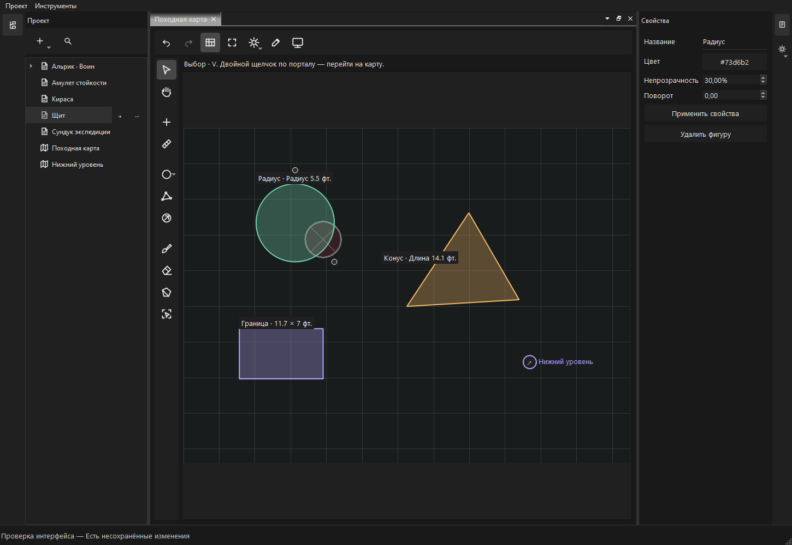
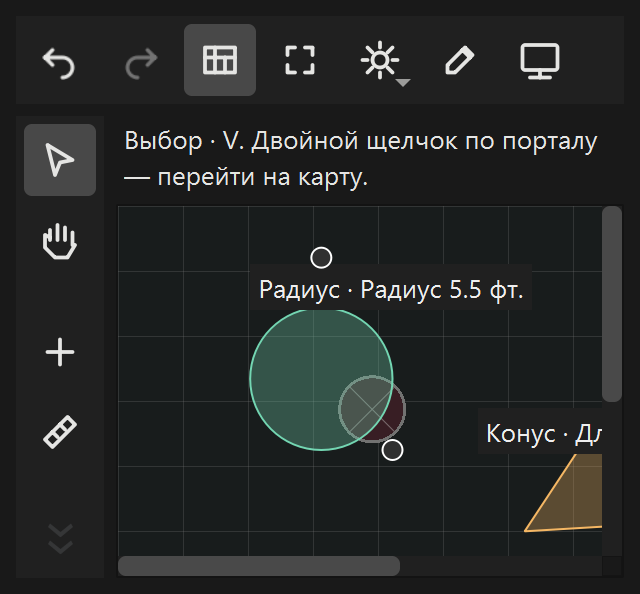
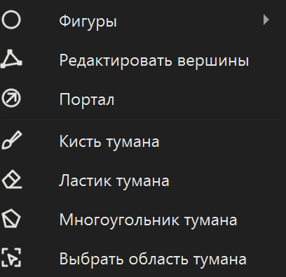
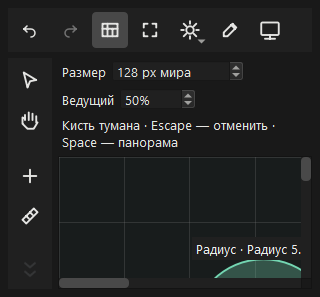

# Снимки production Qt — Map M5.5

Все изображения сняты QWidget.grab с production widgets на Windows в одноразовом мире.
DPR подтверждён evidence.json в каждом каталоге; физическая приёмка мониторов отдельно.

## Масштаб 1

[24-m55-unified-wide](scale-1/24-m55-unified-wide.png) · [25-m55-measure](scale-1/25-m55-measure.png) · [26-m55-fog-brush](scale-1/26-m55-fog-brush.png) · [27-m55-fog-polygon](scale-1/27-m55-fog-polygon.png) · [28-m55-shape-menu](scale-1/28-m55-shape-menu.png) · [29-m55-portal](scale-1/29-m55-portal.png) · [23-m5-map-narrow](scale-1/23-m5-map-narrow.png) · [30-m55-overflow](scale-1/30-m55-overflow.png) · [31-m55-overflow-menu](scale-1/31-m55-overflow-menu.png) · [32-m55-narrow-fog](scale-1/32-m55-narrow-fog.png) · [33-m55-narrow-measure](scale-1/33-m55-narrow-measure.png) · [18-m5-player-shapes-over-fog](scale-1/18-m5-player-shapes-over-fog.png) ·

## Масштаб 1.25

[24-m55-unified-wide](scale-1.25/24-m55-unified-wide.png) · [25-m55-measure](scale-1.25/25-m55-measure.png) · [26-m55-fog-brush](scale-1.25/26-m55-fog-brush.png) · [27-m55-fog-polygon](scale-1.25/27-m55-fog-polygon.png) · [28-m55-shape-menu](scale-1.25/28-m55-shape-menu.png) · [29-m55-portal](scale-1.25/29-m55-portal.png) · [23-m5-map-narrow](scale-1.25/23-m5-map-narrow.png) · [30-m55-overflow](scale-1.25/30-m55-overflow.png) · [31-m55-overflow-menu](scale-1.25/31-m55-overflow-menu.png) · [32-m55-narrow-fog](scale-1.25/32-m55-narrow-fog.png) · [33-m55-narrow-measure](scale-1.25/33-m55-narrow-measure.png) · [18-m5-player-shapes-over-fog](scale-1.25/18-m5-player-shapes-over-fog.png) ·

## Масштаб 1.5

[24-m55-unified-wide](scale-1.5/24-m55-unified-wide.png) · [25-m55-measure](scale-1.5/25-m55-measure.png) · [26-m55-fog-brush](scale-1.5/26-m55-fog-brush.png) · [27-m55-fog-polygon](scale-1.5/27-m55-fog-polygon.png) · [28-m55-shape-menu](scale-1.5/28-m55-shape-menu.png) · [29-m55-portal](scale-1.5/29-m55-portal.png) · [23-m5-map-narrow](scale-1.5/23-m5-map-narrow.png) · [30-m55-overflow](scale-1.5/30-m55-overflow.png) · [31-m55-overflow-menu](scale-1.5/31-m55-overflow-menu.png) · [32-m55-narrow-fog](scale-1.5/32-m55-narrow-fog.png) · [33-m55-narrow-measure](scale-1.5/33-m55-narrow-measure.png) · [18-m5-player-shapes-over-fog](scale-1.5/18-m5-player-shapes-over-fog.png) ·

## Масштаб 2

[24-m55-unified-wide](scale-2/24-m55-unified-wide.png) · [25-m55-measure](scale-2/25-m55-measure.png) · [26-m55-fog-brush](scale-2/26-m55-fog-brush.png) · [27-m55-fog-polygon](scale-2/27-m55-fog-polygon.png) · [28-m55-shape-menu](scale-2/28-m55-shape-menu.png) · [29-m55-portal](scale-2/29-m55-portal.png) · [23-m5-map-narrow](scale-2/23-m5-map-narrow.png) · [30-m55-overflow](scale-2/30-m55-overflow.png) · [31-m55-overflow-menu](scale-2/31-m55-overflow-menu.png) · [32-m55-narrow-fog](scale-2/32-m55-narrow-fog.png) · [33-m55-narrow-measure](scale-2/33-m55-narrow-measure.png) · [18-m5-player-shapes-over-fog](scale-2/18-m5-player-shapes-over-fog.png) ·

